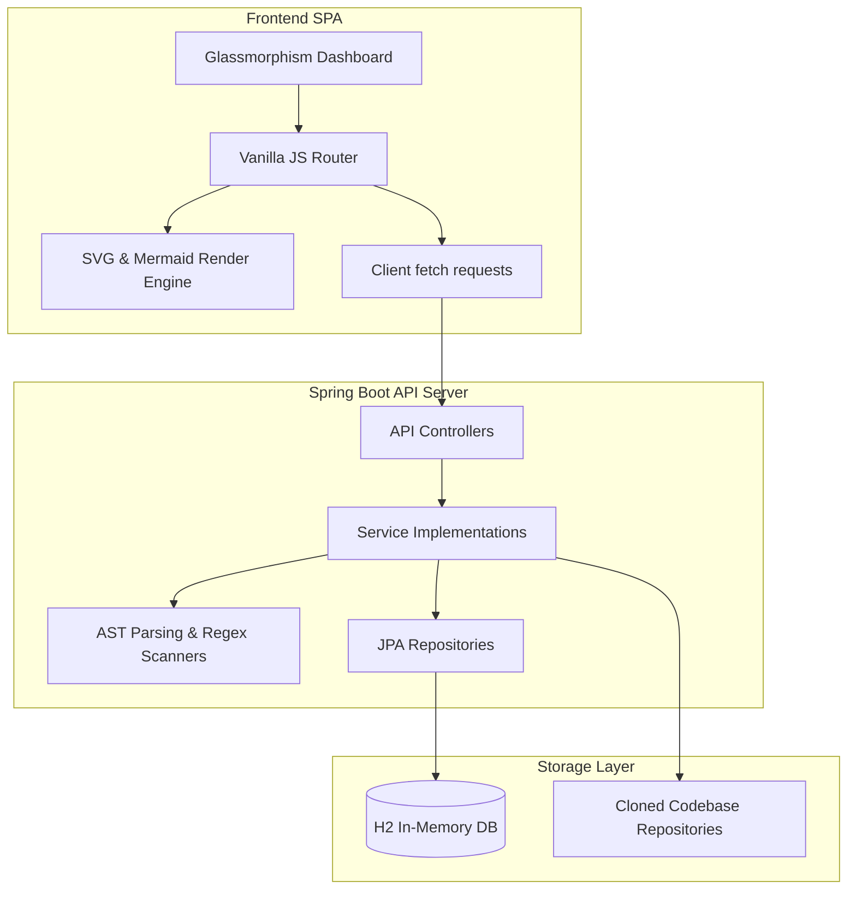

# System Architecture Specification

This document details the system design, parsing mechanics, and database schemas for **CodeNavigator AI**.

---

## 1. System Block Layout

CodeNavigator AI follows a clean, decoupled MVC/Client-Server architecture:



---

## 2. Scanning & Parsing Mechanics

- **Repository Cloner Service**: Dynamically pulls remote Git repositories using system clone commands and checks directory tree structures.
- **AST Source Code Parser (JavaParser)**:
  - Generates Abstract Syntax Trees (AST) for Java codebase source files.
  - Resolves packages, fields, method declarations, parameters, imports, and inheritance trees.
- **Regex Scanners**:
  - Used for non-Java source structures (Python, JS) to map method signatures, check naming formats, and search for dangerous regex matches.
- **Mermaid Diagram Generator**:
  - Translates AST classes metadata and folder trees into raw text Mermaid scripts, compiling Class, Package, Component, Sequence, Use Case, and Deployment schemas.

---

## 3. Database Schema Mapping

```mermaid
erDiagram
    USERS ||--o{ CODE_REPOSITORIES : owns
    USERS ||--o{ ANALYSIS_RECORDS : requests
    CODE_REPOSITORIES ||--o{ ANALYSIS_RECORDS : references
    ANALYSIS_RECORDS ||--o? ARCHITECTURE_RESULTS : has
    ANALYSIS_RECORDS ||--o? SOURCE_CODE_RESULTS : has
    ANALYSIS_RECORDS ||--o? API_DOCUMENTATION_RESULTS : has
    ANALYSIS_RECORDS ||--o? DATABASE_RESULTS : has
    ANALYSIS_RECORDS ||--o? CODE_QUALITY_RESULTS : has
    ANALYSIS_RECORDS ||--o? SECURITY_RESULTS : has
    ANALYSIS_RECORDS ||--o? DIAGRAM_RESULTS : has
```

### Table Dictionary

#### 1. `users`
* `id` (BIGINT PK, Identity)
* `email` (VARCHAR, Unique)
* `password` (VARCHAR)
* `full_name` (VARCHAR)
* `enabled` (BOOLEAN)

#### 2. `code_repositories`
* `id` (BIGINT PK, Identity)
* `owner_id` (BIGINT FK -> `users.id`)
* `repo_name` (VARCHAR)
* `repo_url` (VARCHAR)
* `clone_path` (VARCHAR)
* `status` (VARCHAR - CLONING, COMPLETED, FAILED)
* `primary_language` (VARCHAR)

#### 3. `analysis_records`
* `id` (BIGINT PK, Identity)
* `repository_id` (BIGINT FK -> `code_repositories.id`)
* `requested_by` (BIGINT FK -> `users.id`)
* `type` (VARCHAR - ARCHITECTURE, SOURCE_CODE, API_DOCUMENTATION, DATABASE, CODE_QUALITY, SECURITY)
* `status` (VARCHAR - RUNNING, COMPLETED, FAILED)

#### 4. `architecture_results`
* `id` (BIGINT PK, Identity)
* `analysis_record_id` (BIGINT FK -> `analysis_records.id`)
* `package_structure_json` (LONGTEXT)
* `dependency_graph_json` (LONGTEXT)

#### 5. `diagram_results`
* `id` (BIGINT PK, Identity)
* `analysis_record_id` (BIGINT FK -> `analysis_records.id`)
* `class_diagram` (LONGTEXT)
* `package_diagram` (LONGTEXT)
* `component_diagram` (LONGTEXT)
* `sequence_diagram` (LONGTEXT)
* `use_case_diagram` (LONGTEXT)
* `architecture_diagram` (LONGTEXT)

#### 6. `code_quality_results`
* `id` (BIGINT PK, Identity)
* `analysis_record_id` (BIGINT FK -> `analysis_records.id`)
* `quality_score` (INT)
* `issues_json` (LONGTEXT)
* `quality_summary` (LONGTEXT)

#### 7. `security_results`
* `id` (BIGINT PK, Identity)
* `analysis_record_id` (BIGINT FK -> `analysis_records.id`)
* `vulnerabilities_count` (INT)
* `vulnerabilities_json` (LONGTEXT)
* `security_summary` (LONGTEXT)
